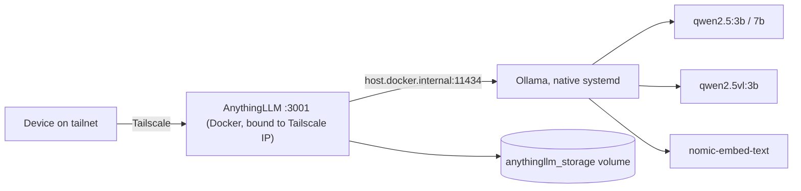

## Network path

1. A tailnet device opens `http://<tailscale-ip>:3001`.
2. AnythingLLM runs on the `local-ai_default` bridge network and calls Ollama through the `host-gateway` alias, which resolves to the Docker bridge address of the host.
3. UFW allows that traffic only from the AnythingLLM subnet. Without this rule the connection is silently dropped, because Docker-originated traffic is not covered by the `tailscale0` allow rule.

## Exposure

| Component | Binding | Protected by |
| --- | --- | --- |
| AnythingLLM | `<tailscale-ip>:3001` | Bind address (tailnet only) |
| Ollama | `*:11434` (`OLLAMA_HOST=0.0.0.0`) | UFW: tailnet and AnythingLLM subnet only |

Ollama must listen beyond loopback so the container can reach it, so the firewall is the control. A tighter option is binding Ollama to the Docker bridge address only, at the cost of breaking host-local clients on `127.0.0.1`.

## State

- Ollama models: `~/.ollama` (not committed).
- AnythingLLM data: external Docker volume `anythingllm_storage` (back it up before upgrades).
- Configuration: `.env` (git-ignored); `.env.example` documents the variables.

## Operational notes

- The compose file currently tracks `latest`; pin the image tag for reproducible deployments.
- Pin the network subnet in `compose.yaml` so the UFW rule cannot drift if the network is recreated.
